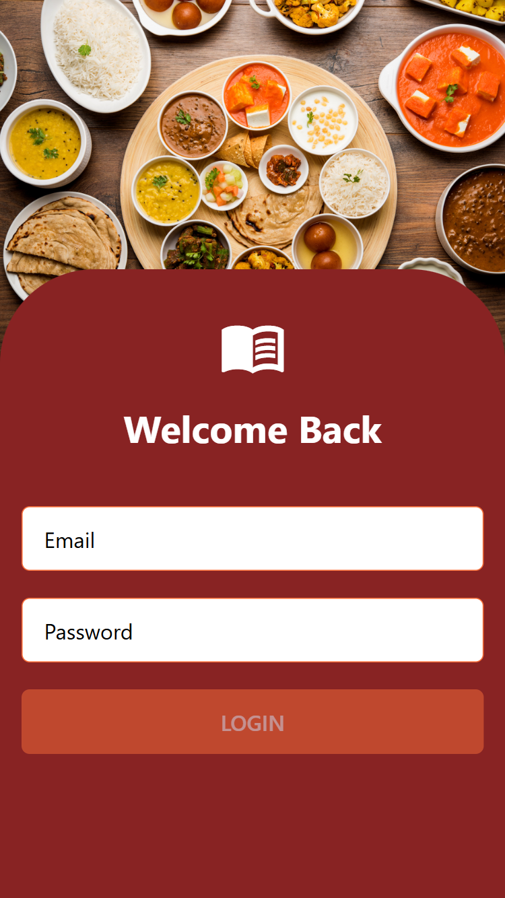
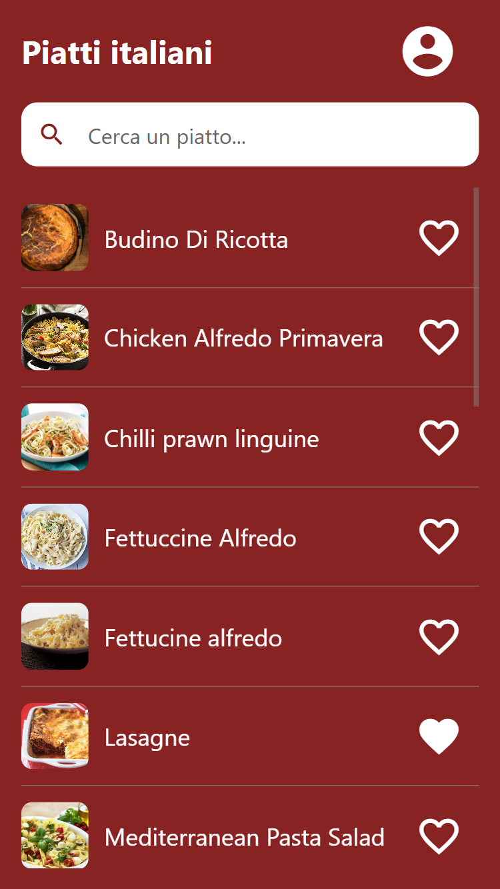
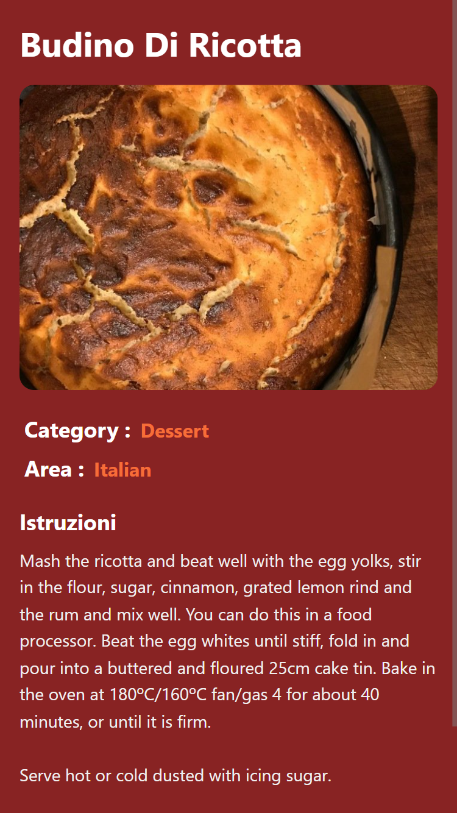
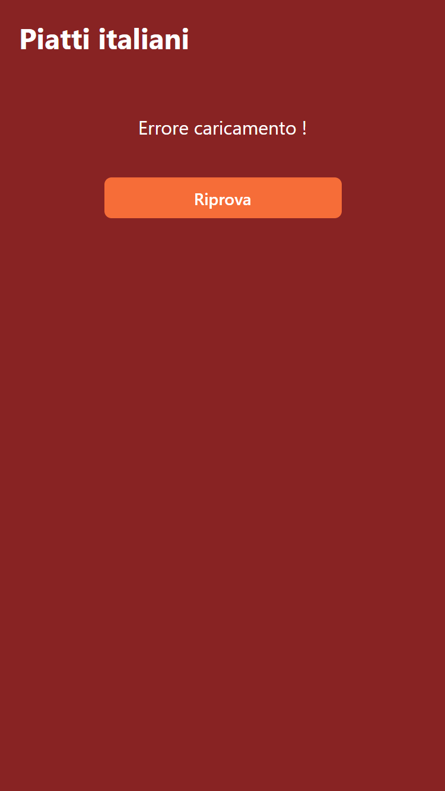
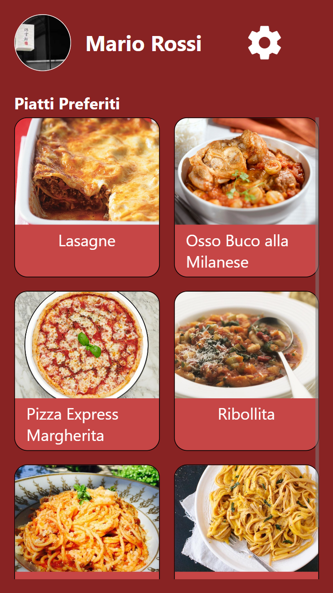
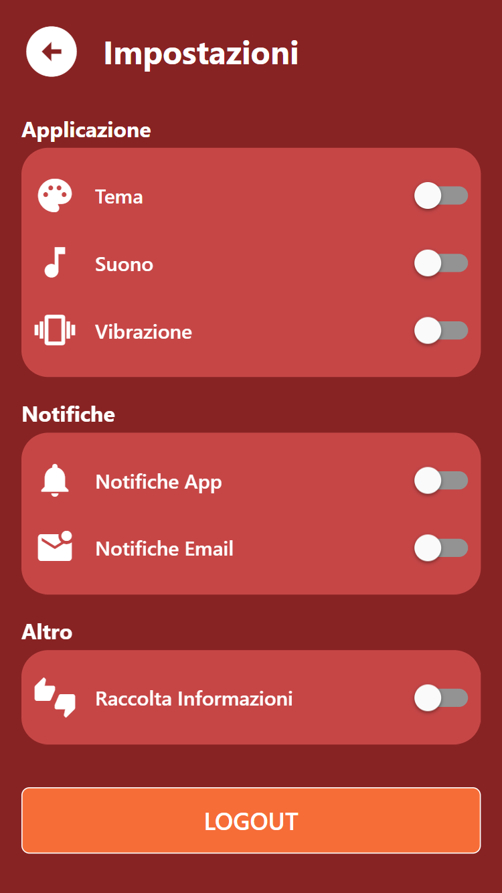

# Progress - Italian Meals App

**Studente:** Mirko Mento  
**Repo:** https://github.com/mirkomentoITS/meal-app 
**Ultimo aggiornamento:** 2026-07-7

## Schermate implementate

| Schermata      | Stato   | Screenshot                                          |
| -------------- | ------- | --------------------------------------------------- |
| Login          |   ✅    |            |
| Lista piatti   |   ✅    |             |
| Ricerca        |   ✅    |           |
| Dettaglio      |   ✅    |       |
| Errore + Retry |   ✅    |           |
| Preferiti      |   ✅    |      |
| Impostazioni   |   ✅    |  |
| Deep link      |   ✅    |     |

## Google Doc (lab 13–22)

**Link:** 
https://docs.google.com/document/d/1RXdJJVh4GlMYAngYksM9MLcUvdgkYoO3lizdgMCK36Y/edit?tab=t.0#heading=h.wu29v8o1b6lm

Uno screenshot per lab **13–22** (come avete fatto per i lab **01–11**).

## Note

- gps opzionale (lab 20)
- notifiche opzionali (lab 21)